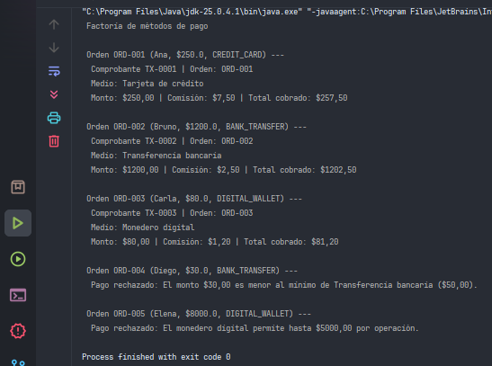

# Ejercicio 06 – Factoría de métodos de pago para comercio electrónico

## Descripción

Una plataforma de comercio electrónico procesa pagos con distintas pasarelas (tarjeta de crédito, transferencia bancaria y monedero digital). Cada una tiene sus propias comisiones y reglas de validación, y la pasarela correcta debe elegirse a partir de los datos de la orden de compra.

## Objetivos

- Crear dinámicamente servicios de procesamiento financiero desde un punto centralizado y polimórfico.
- Aplicar el recargo o la validación particular de cada medio de pago.
- Validar en la factoría que el monto cumpla el mínimo de la pasarela elegida.

## Implementación del patrón Factory Method

| Rol en el patrón | Clase |
|---|---|
| Producto (interfaz) | `PaymentGateway` (`charge()` devuelve un `Receipt`) |
| Productos concretos | `CreditCardGateway`, `BankTransferGateway`, `DigitalWalletGateway` |
| Creador (abstracto) | `PaymentCreator` (método de fábrica `createGateway()` + `createValidatedGateway()`) |
| Creadores concretos | `CreditCardCreator`, `BankTransferCreator`, `DigitalWalletCreator` |
| Selección según la orden | `PaymentCreatorSelector` (usa `PurchaseOrder` y `PaymentMethod`) |
| Cliente | `Main` |

`createValidatedGateway(order)` llama al método de fábrica y, antes de devolver la pasarela, comprueba que `order.getAmount()` alcance el monto mínimo del medio de pago.

| Medio | Mínimo | Comisión / regla propia |
|---|---|---|
| Tarjeta de crédito | $10 | Recargo del 3 % |
| Transferencia bancaria | $50 | Comisión fija de $2,50 |
| Monedero digital | $5 | Recargo del 1,5 % y tope de $5000 por operación |

## Propósito de la clase

| Clase | Propósito |
|---|---|
| `PaymentGateway` | Interfaz común de cobro: `charge()`, `getMinimumAmount()` y `getName()`. |
| `CreditCardGateway` / `BankTransferGateway` / `DigitalWalletGateway` | Aplican la comisión y las reglas de cada medio. |
| `Receipt` | Comprobante de transacción con id, monto, comisión y total. |
| `PaymentCreator` | Declara el método de fábrica, valida el monto mínimo y ofrece `processPayment()`. |
| `CreditCardCreator` / `BankTransferCreator` / `DigitalWalletCreator` | Construyen la pasarela de su medio. |
| `PaymentCreatorSelector` | Elige el creador según el medio indicado en la orden. |
| `PurchaseOrder`, `PaymentMethod` | Datos de la orden y medios disponibles. |
| `InvalidPaymentException` | Error cuando la orden no cumple las reglas. |
| `Main` | Procesa órdenes válidas e inválidas. |

## Concepto clave

La factoría no solo crea el objeto: también **protege la creación** verificando una regla de negocio (monto mínimo). Así el cliente recibe siempre una pasarela apta para esa orden, y cada medio mantiene sus comisiones encapsuladas.

## Resultado

## Conclusión

Factory Method centraliza la elección y construcción de pasarelas de pago de forma polimórfica. Agregar un medio nuevo (por ejemplo, criptomonedas) requiere una pasarela, un creador y su registro en el selector, sin tocar el resto del sistema.
